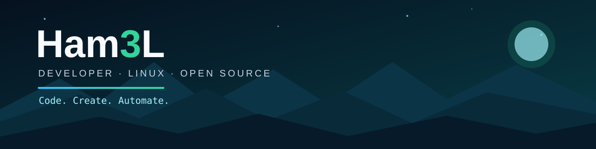

### `> Code. Create. Automate._`

### Über mich

Ich bin **Ham3L** und beschäftige mich mit moderner Webentwicklung, Linux, Self-Hosting und intelligenter Automatisierung. Ich entwickle persönliche Projekte, probiere neue Technologien aus und optimiere bestehende Workflows – mit einem Fokus auf Performance, Wartbarkeit und praktische Lösungen.

- **Web:** Astro, TypeScript, JavaScript und moderne Frontends
- **Systeme:** Debian, Linux, Serveradministration und Self-Hosting
- **Automatisierung:** Shell-Skripte, GitHub Actions und KI-gestützte Entwicklung
- **Interessen:** Open Source, Datenschutz und schlanke Infrastruktur

### Tech Stack

**Sprachen**

**Frameworks & Tools**

**Infrastruktur**

### Projekte

| Projekt | Schwerpunkt | Links |
| --- | --- | --- |
| **Ham3L** | Persönliche Website mit Astro, Design und Animationen | [Website](https://ham3l.cloud) · [Repository](https://github.com/klatschanstalt/ham3l.cloud) |
| **c0re.pw** | Webplattform, Automatisierung und Linux-Betrieb | [Website](https://c0re.pw) · [Repository](https://github.com/klatschanstalt/c0re-pw) |

[Weitere Repositories ansehen](https://github.com/klatschanstalt?tab=repositories)

### GitHub-Aktivität

### Vernetzt bleiben

[Website](https://ham3l.cloud) · [Reddit](https://www.reddit.com/user/ham3l/) · [DEV.to](https://dev.to/ham3l) · [LinkedIn](https://www.linkedin.com/in/ham3l/)

---

**Keep building. Keep learning.**

*Neugier ist der Anfang. Code ist das Werkzeug.*

