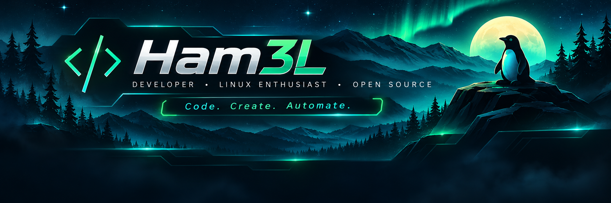

<div align="center">



<br>

[](https://ham3l.cloud)
[](https://github.com/klatschanstalt)
[](https://www.linkedin.com/in/ham3l/)
[](https://x.com/ham3l)

<br>

[](https://git.io/typing-svg)

</div>

---

## 👨‍💻 Über mich

**Hi, ich bin Ham3L!**

Technologie ist für mich mehr als nur Code. Mich begeistert die Möglichkeit, eigene Ideen umzusetzen, Systeme zu verstehen und aus komplexen Anforderungen einfache, funktionierende Lösungen zu entwickeln.

Meine Schwerpunkte liegen in der modernen Webentwicklung, Linux-Systemadministration, Automatisierung und dem Einsatz künstlicher Intelligenz in Entwicklungsprozessen.

Ich experimentiere gerne mit neuen Technologien, entwickle eigene Projekte und optimiere bestehende Lösungen. Dabei lege ich Wert auf **Performance, Sicherheit, Datenschutz und eine möglichst schlanke Architektur**.

```yaml
profile:
  alias: Ham3L
  location: Germany
  interests:
    - Web Development
    - Linux & Self-Hosting
    - AI & Automation
    - Open Source
    - DevOps
  philosophy: "Keep it simple. Make it better."
```

---

## ⚡ Was mich antreibt

- **Entwickeln:** Moderne, performante Websites und individuelle Anwendungen gestalten.
- **Verstehen:** Linux-Systeme, Netzwerke und technische Zusammenhänge analysieren.
- **Automatisieren:** Wiederkehrende Aufgaben durch intelligente Workflows vereinfachen.
- **Experimentieren:** Neue Frameworks, KI-Werkzeuge und Open-Source-Projekte ausprobieren.
- **Optimieren:** Bestehende Lösungen sicherer, schneller und wartungsfreundlicher machen.

---

## 🛠️ Tech Stack

<div align="center">

### Languages


### Frameworks & Runtime


### Infrastructure & DevOps


</div>

---

## 🚀 Featured Projects

### 🌐 Ham3L — Personal Website

Meine persönliche Website und digitale Visitenkarte.

Ein individuell gestaltetes Webprojekt mit modernen Frontend-Technologien, responsivem Design, Animationen und einem besonderen Fokus auf Benutzererlebnis und Performance.

**Stack:** `Astro` `TypeScript` `CSS`

[](https://ham3l.cloud)
[](https://github.com/klatschanstalt/ham3l.cloud)

### ⚙️ c0re.pw — Web Platform

Ein persönliches Webprojekt mit Schwerpunkt auf moderner Architektur, Linux-Infrastruktur und automatisierten Entwicklungs- und Deployment-Prozessen.

Im Mittelpunkt stehen zuverlässiger Betrieb, Sicherheit, Performance und die möglichst effiziente Verwaltung technischer Abläufe.

**Stack:** `Astro` `TypeScript` `SQLite` `Linux`

[](https://c0re.pw)
[](https://github.com/klatschanstalt/c0re-pw)

<br>

<div align="center">

[](https://github.com/klatschanstalt?tab=repositories)

</div>

---

## 📊 GitHub Analytics

<div align="center">


<br>


</div>

---

## 🌐 Connect with me

<div align="center">

[](https://ham3l.cloud)
[](https://www.reddit.com/user/ham3l/)
[](https://dev.to/ham3l)
[](https://www.linkedin.com/in/ham3l/)

<br>

---

[](https://git.io/typing-svg)

*Neugier ist der Anfang. Code ist das Werkzeug.*

</div>
